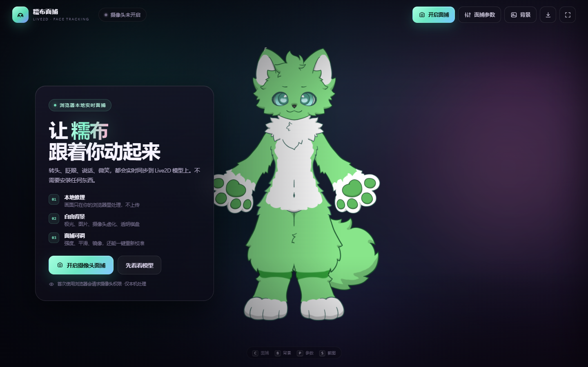

# WebL2D · Live2D 面捕

在浏览器里用摄像头实时驱动任意 Live2D 模型：转头、眨眼、说话、微笑都会同步到模型上，并支持自定义背景、可编辑的参数映射表、表情触发、音频口型和多模型切换。所有画面与推理都在本机浏览器内完成，没有服务器，也不会上传。



> 本次更新的完整说明见 **[RELEASE_NOTES.md](RELEASE_NOTES.md)**。

## 本次更新

- **映射工作台**：一个摄像头输入可以拆到多个模型参数，每个目标独立曲线/镜像，空组、自动眨眼和按模型保存都能用。
- **换模型不用重调**：映射、视图、手感、物理、表情快捷键和音频设置都按模型保存；模型自己的物理分组会直接变成控制项。
- **直播和调节都留在网页里**：OBS 透明模式、PNG 截图、触屏手势、配置导入导出和本机缓存全部在页面内完成。
- **麦克风元音口型**：A/I/U/E/O 独立驱动，支持逐音校准、权重和 0–150ms 过渡；权重总和不是 500% 时会红色提醒。

## 功能

- **摄像头面捕**：浏览器内实时面捕，不依赖桌面客户端。
- **可编辑映射表**：像 VTS 一样自由设置「摄像头参数范围 → 模型参数范围」；一个摄像头参数可以映射到多个模型参数，同一个模型参数只能出现在一个组里。不需要面捕的参数可以直接不映射（或放进空对照组）。
- **映射曲线**：每个目标参数可选线性 / 柔和 / 强烈 / S 曲线，并可开启正负镜像；左右转头、眼神、眉毛这类有正负的来源会保持对称手感。
- **空对照组 / 自动眨眼**：只有模型参数、没有摄像头参数的组不参与面捕；目标是眼睛开合时可以打开「自动眨眼」。
- **自动校准**：开启后保持正脸约 1 秒，自动记录头部中点、眨眼/眉毛/眼神/嘴型静息值。
- **表情触发**：带 Expressions 的模型会在舞台右侧显示表情按键，也可以给每个表情绑定快捷键；当前糯布模型没有表情文件，所以不会显示表情栏。
- **麦克风元音口型**：默认关闭，手动打开后才申请麦克风；支持 A/I/U/E/O 元音、逐音校准、独立权重和 0–150ms 过渡，权重总和偏离 500% 会红色提醒。
- **物理手感**：按当前模型 `physics3.json` 的分组动态生成强度滑杆（分组名来自模型本身），再提供呼吸幅度/速度和物理平滑；不改写物理输出参数。
- **多模型切换**：顶栏下拉或「视图 → 模型」切换 `L2d_model / L2d_models` 里的模型；映射表、视图、手感、表情快捷键、物理设置都按模型保存在本机缓存。
- **鼠标 / 触屏**：左键拖拽、中键复位、滚轮缩放；触屏支持单指拖拽、双指捏合缩放/平移、双击复位。
- **自定义背景**：极光、暮色、纯色、上传图片（支持拖入）、摄像头实时虚化、透明棋盘；可调模糊和压暗。
- **OBS 透明直播**：`?stream=1` 自动启用 `css/obs.css`，只保留模型画布，隐藏所有网页 UI 并强制透明背景。
- **配置导入导出**：映射、曲线、每模型视图/手感/物理、表情快捷键、音频设置可导出 JSON；背景图可选。
- **截图 / 全屏**：截图会把当前背景和模型合成为 PNG，不包含网页 UI。
- **纯本地**：依赖、模型、WASM 都在站点目录里；用户设置只进本机 localStorage。

## 本地运行

需要 **Python 3.9+**（Windows 上也可以用 `py -3`）。

1. 双击 **`start.cmd`**。
2. 浏览器会自动打开 `http://127.0.0.1:5180/`（端口被占用时会自动换一个，以窗口里的地址为准）。
3. 点「开启摄像头面捕」，允许摄像头权限。

或者手动启动：

```bash
python server.py --open
```

> 不能直接双击 `index.html`：ES Module、WASM 和摄像头权限都需要通过 `http://127.0.0.1`（或 HTTPS）访问。
>
> 本地 `server.py` 会动态扫描模型目录并提供 `/api/models`，新放进去的模型刷新列表就能看到。

## 部署到 GitHub Pages

这是**纯静态站点**：没有构建步骤、没有后端、没有 npm 依赖安装。

### 方式 A：GitHub Actions（推荐，仓库已带 workflow）

1. 把 **`WebL2D` 文件夹里的内容**作为仓库根目录推送（`index.html`、`.nojekyll`、`.github/workflows/pages.yml` 都要在根目录）。
2. 仓库 **Settings → Pages → Build and deployment → Source** 选择 **GitHub Actions**。
3. 推送到 `main`（或 `master`）后，Actions 会自动执行 `.github/workflows/pages.yml`；默认分支不是这两个时，在 Actions 页面手动点一次 **Run workflow**。
4. 部署完成后的地址：
   - 普通仓库：`https://<用户名>.github.io/<仓库名>/`
   - 用户主页仓库（仓库名 `<用户名>.github.io`）：`https://<用户名>.github.io/`

### 方式 B：从分支直接发布

1. 把内容推到 GitHub 的 `main` 分支。
2. **Settings → Pages → Source** 选择 **Deploy from a branch**，分支 `main`，目录 `/ (root)`。
3. 保存后等待 1–2 分钟。根目录的 `.nojekyll` 会阻止 Jekyll 处理这些静态文件。

> 方式 A 和方式 B 二选一。选方式 B 时建议把 `.github/workflows/pages.yml` 删除或停用，避免 Actions 里出现失败的部署记录；这不影响分支发布本身。

### 部署注意

- 必须把 `WebL2D` **里面的内容**放在仓库根目录，不要再多套一层 `WebL2D/`；否则站点地址会变成 `.../<仓库名>/WebL2D/`。如果确实要放子目录，请把 workflow 里 `Prepare static site` 的路径改成对应子目录。
- 所有资源都使用相对路径，因此项目页 `/<仓库名>/` 和用户页 `/` 都能正常工作。
- GitHub Pages 默认提供 HTTPS，摄像头权限可以正常申请；不要用 HTTP 的局域网地址访问。
- `.task`、`.wasm` 合计约 22MB，远低于 GitHub Pages 单文件 100MB / 站点 1GB 的限制。
- 已内置 `.mjs` 的 MIME 回退：如果 Pages 把 `vision_bundle.mjs` 返回成 `application/octet-stream`，会自动改用 Blob 方式加载。
- 每次部署前 workflow 都会运行 `scan_models.py` 刷新 `models.json`，保证新加的模型能被列出。
- 不要把 `.deps/`、`_dev/` 提交到仓库，`.gitignore` 已经排除。

## 使用方式

- **第一次进入**：可以点「先看看模型」进入浏览模式；鼠标移动时模型会追着光标看。
- **开启面捕**：点右上角相机按钮或欢迎页的「开启摄像头面捕」。首次浏览器会请求权限。
- **校准**：开启后保持正脸约 1 秒，状态栏显示「正在校准」。换人、换姿势后，在「面捕参数 → 摄像头 → 重新校准」再校准一次。
- **拖拽 / 缩放**：左键按住模型拖动位置，中键复原位置，滚轮缩放；「视图」里也有滑杆，重置按钮会同时恢复位置和缩放。页面底部也常驻显示这三个鼠标操作提示。
- **触屏**：单指拖动、双指捏合缩放、双指平移、双击复位。
- **切换模型**：桌面顶栏的模型下拉，或「视图 → 模型 → 当前模型」；移动端用后者。每个模型的本机视图/手感/物理会分别记住。
- **表情**：带 Expressions 的模型会在舞台右侧显示表情按钮；在「表情」页可以隐藏按键栏并为每个表情绑定快捷键。当前糯布模型没有表情文件，这一栏会显示不可用。
- **麦克风口型**：在「面捕 → 音频口型」打开；默认关闭，打开后才请求麦克风。灵敏度、噪声门可调。
- **物理手感**：在「面捕 → 物理手感」调整当前模型每个 physics 分组的强度，以及呼吸幅度/速度和物理平滑；复位按钮恢复默认。
- **背景**：右上角「背景」打开面板，选预设或上传图片。图片也可以直接拖进页面。
- **截图**：右上角下载图标，或按 `S`。截图会带上当前背景。
- **配置**：「视图 → 配置」导出/导入 JSON；「视图 → 当前模型」可单独重置当前模型设置。
- **OBS 透明直播**：「视图 → 直播 / OBS」进入直播模式，或访问 `?stream=1`；按 `Esc` 退出。
- **隐藏摄像头预览**：预览右上角的 ×；在「视图」里可以重新打开。

### 快捷键

| 键 | 功能 |
| --- | --- |
| `C` | 开启 / 关闭摄像头 |
| `B` | 打开背景面板 |
| `P` | 打开参数映射面板 |
| `S` | 保存截图 |
| `F` | 全屏 |
| `Esc` | 关闭面板 / 退出直播模式 |
| 自定义 | 「表情」页可为每个表情绑定快捷键（按模型保存） |

## 参数映射

「面捕参数」按钮（或 `P`）打开「映射」标签页。

- 每一组包含：**一个摄像头来源**、输入范围、若干**模型目标参数**及各自的输出范围。
- 一个摄像头来源可以出现在多个组里，也可以在同一组里映射到多个模型参数。
- **同一个模型参数只能出现在一个组里**；下拉里只会出现还没被使用的参数，防止重复。
- 把来源改成「无（空对照组）」后，该组不参与面捕，目标使用模型默认值。
- 空对照组里如果有 `ParamEyeLOpen / ParamEyeROpen`，会出现「自动眨眼」开关。
- 「+ 对照组」新建带摄像头来源的组；「+ 空对照组」新建只有模型参数的组。
- 「恢复默认」会重建默认映射（头部、眼睛、眼神、嘴、表情、眉毛、舌头、鼻子）。默认映射使用 Cubism 标准参数 ID，模型没有的参数会自动跳过；当前模型的任意参数都可以在目标下拉里手动添加。

输入范围是**校准后摄像头值的范围**，输出范围是**写入模型的值范围**。两个范围都可以反向填写（例如眼睛开合用 `1 → 0` 表示闭眼），用于处理方向相反的参数。

每个目标参数还有一条**响应曲线**：线性、柔和、强烈、S 曲线。开启「正负镜像」后，带正负的来源（头部左右、歪头、眼神、眉毛、嘴型）会按 `f(-x) = -f(x)` 的方式对称响应，不会出现往左和往右手感不对称的问题。

## 表情 / 音频 / 物理

### 表情触发

- 模型带有 `FileReferences.Expressions` 时，舞台右侧出现表情按键。
- 当前表情高亮，点击「清除当前」或再次切换即可复位。
- 在「表情」页可隐藏按键栏，并为每个表情录制快捷键；快捷键按模型保存在本机。
- 当前「糯布」模型没有 Expressions，所以这个功能会显示“当前模型没有表情文件”；换带表情的模型即可使用。

### 麦克风口型

- 从模型 `Groups` 里的 `LipSync` 识别口型参数；没有 LipSync 的模型开关会禁用。
- 模型若有元音口型的 `ParamSilence` 开关：没有元音输入时为 **1**（普通 Open/Smile 生效）；`ParamSilence = 1 - (A*wA + I*wI + U*wU + E*wE + O*wO)`，元音总和越大越低，归零时由元音口型接管。默认权重 `A=0.6, I=0.75, U=1.55, E=0.55, O=1.55`（合计 **500%**），即 U/O 更积极、A/E 更保守。
- 模型有 A/I/U/E/O 元音参数时，打开麦克风会驱动这些元音；普通 Open/Smile 仍保留摄像头值，由 Silence 混合权重让元音口型覆盖它。没有元音参数的模型回退到 `ParamMouthOpenY`。
- 音频页可调 **A/I/U/E/O 权重** 和 **0–150ms 元音过渡**：权重越高越容易压低 Silence；过渡 0ms 接近瞬切，45ms 左右兼顾衔接和响应。五个权重合计应为 **500%**，否则界面会用红色提示；设置会保存在本机并随配置导出。
- **元音使用短交叉过渡**（默认约 45ms），而不是慢速平滑：保留连续说话的衔接，但不会拖成慢动作。音频分析也使用更短的 FFT 窗口和更低的频谱平滑。
- 音频页提供 A/I/U/E/O **逐个校准**：点对应「校准」，持续发那个元音约 1 秒；校准结果保存在本机，和配置一起导出。
- 默认关闭；打开开关时才申请麦克风权限。
- 启动后先用约 0.5 秒估计环境底噪，再叠加静音门限（噪声门）；静音时所有元音会回到 0。
- 可调灵敏度和静音门限；关闭开关、切换模型或离开页面会停止麦克风。

### 物理手感

- 按当前模型 `physics3.json` 的 `PhysicsDictionary` 动态显示每个 physics 分组的强度滑杆，名称完全来自模型本身；不同模型会有不同的分组。
- 还可以调呼吸幅度、呼吸速度和物理平滑（阻尼）。
- 调整的是物理内部的分组输出强度和粒子阻尼，**不会**直接写物理输出参数，也不会破坏自然晃动。
- 不同模型的物理参数分别保存在本机缓存。

## OBS 透明直播

1. 打开「视图 → 直播 / OBS」，点「进入透明直播模式」；或访问 `http://127.0.0.1:5180/?stream=1`。
2. 在 OBS 添加 **浏览器源**，地址用 `http://127.0.0.1:5180/?stream=1`，宽高 1920×1080，勾选「不可见时关闭源」。
3. 直播模式会隐藏顶栏、控制台、提示、欢迎页和摄像头预览，背景强制透明；按 `Esc` 退出。

OBS 专用样式表在 `css/obs.css`，它只保留 `#stage` 和 Live2D canvas，隐藏其他所有 UI。页面带 `?stream=1` 时会自动启用；如果要在 OBS 里手动加自定义 CSS，也可以直接粘贴这个文件。

> 透明背景推流由 OBS 完成，网页本身不编码 RTMP。OBS 浏览器源是否允许摄像头取决于 OBS 的 CEF 权限；如果摄像头被拒绝，透明源仍可用于待机/鼠标跟随，面捕可改用普通浏览器窗口捕获。

默认映射大致对应之前的手感：

| 摄像头来源 | 默认模型参数 |
| --- | --- |
| 头部左右 | `ParamAngleX` |
| 抬头 / 低头 | `ParamAngleY` |
| 歪头 | `ParamAngleZ` |
| 左 / 右眼眨眼 | `ParamEyeLOpen` / `ParamEyeROpen` |
| 眼神左右 / 上下 | `ParamEyeBallX` / `ParamEyeBallY` |
| 嘴巴张开 | `ParamMouthOpenY` |
| 嘴型（笑 / 皱） | `ParamMouthForm` |
| 微笑强度 | `ParamEyeLSmile`、`ParamEyeRSmile`、`ParamCheek` |
| 左 / 右眉毛 | `ParamBrowLY` / `ParamBrowRY` |
| 吐舌头 | `ParamTongue` |
| 皱鼻子 | `ParamNose` |

没有被任何组使用的面捕参数会自动复位到模型默认值，不会被上一次的摄像头值残留驱动。

**物理参数单独交给模型 physics**：`physics3.json` 里的输出参数（例如 `ParamBodyAngleX`、Q 耳、尾巴、头发等，具体以模型为准）由 physics 计算，呼吸由系统节奏驱动；它们不会出现在映射目标里，也不会被每帧复位。这样左右转头时耳朵和尾巴会按物理惯性自然晃动，而不是被面捕值按住不动。


## 多模型

把模型目录放进以下任意目录：

```
L2d_model/你的模型/你的模型.model3.json
L2d_models/你的模型/你的模型.model3.json
```

- **本地**：`server.py` 每次刷新都会扫描目录，点「视图 → 刷新列表」即可看到新模型。
- **GitHub Pages**：运行时读 `models.json` 静态清单；workflow 会自动运行 `scan_models.py`，也可以手动执行：

```bash
python scan_models.py
```

- 模型必须是 Cubism 3/4/5 的 `.model3.json`；Cubism 2 的 `.model.json` 不支持。
- 映射表、视图/手感、表情快捷键、物理设置按模型 ID 分开保存在浏览器 `localStorage`；切换模型不会互相覆盖，也不会上传到仓库。
- `models.json` 里的 `id` 建议保持稳定；重命名 `id` 会让该模型之前的映射和本地配置失效（重新设置即可）。

## 目录结构

```
WebL2D/
├─ index.html                 页面
├─ css/style.css              样式
├─ js/
│  ├─ app.js                  入口 / UI / 模型切换 / 映射 / 表情 / 音频 / 物理 / 直播
│  ├─ scene.js                Live2D 渲染、多模型加载、参数元数据、模型能力、物理调参
│  ├─ tracker.js              摄像头 + MediaPipe + 麦克风音频分析
│  ├─ mapper.js               摄像头/音频来源 → 可配置映射 → Live2D 参数
│  ├─ background.js           背景与截图合成
│  ├─ config.js               设置版本、默认值、曲线、默认映射
│  └─ utils.js                工具函数
├─ vendor/                    PixiJS / Cubism Core / MediaPipe
├─ assets/models/face_landmarker.task
├─ L2d_model/                 模型目录
├─ L2d_models/                也可以把模型放这里
├─ models.json                静态模型清单
├─ .github/workflows/pages.yml GitHub Pages 自动部署
├─ .nojekyll                  GitHub Pages 静态发布标记
├─ .gitignore
├─ server.py                  本地静态服务器 + /api/models 扫描
├─ scan_models.py             生成 models.json
├─ start.cmd                  Windows 本地一键启动
├─ README.md
└─ THIRD_PARTY_NOTICES.md
```

## 常见问题

**摄像头权限被拒绝**
点地址栏左侧的摄像头/站点信息图标，把「摄像头」改为允许，再点一次「开启面捕」。如果之前点了“阻止”，需要在浏览器设置 → 隐私 → 摄像头里找到本站并移除阻止。

**没有找到摄像头 / 摄像头被占用**
确认摄像头没被会议软件、OBS、相机应用占用；笔记本检查键盘上的摄像头开关。设备选择在「面捕参数 → 摄像头 → 设备」。

**页面打不开 / 模型加载失败**
- 本地：请用 `start.cmd` 或 `python server.py --open` 启动，不要直接打开 `index.html`。确认 `L2d_model`、`vendor`、`assets` 三个目录完整。
- GitHub Pages：确认仓库**根目录**有 `index.html`、`vendor/`、`assets/`、`L2d_model/`、`models.json`；确认 Actions 部署成功、Pages 已选择正确分支/Artifact。强刷一次（Ctrl+F5）。

**切换模型后映射没了**
映射按模型 ID 保存。换模型后是另一份映射；切回原模型会恢复。重命名 `models.json` 里的 `id` 会被视为新模型。

**某个参数不参与面捕**
在「映射」里找到包含它的组并删除该目标，或新建「空对照组」把它放进去。没有映射的面捕参数会回到模型默认值。

**眼睛想要自动眨**
把对应眨眼组的来源改成「无（空对照组）」，或新建空对照组并把目标设为 `ParamEyeLOpen` / `ParamEyeROpen`，打开「自动眨眼」。

**为什么没有表情按钮**
当前模型没有 `FileReferences.Expressions`。换一个带表情的模型后，右侧才会出现表情栏；不带表情的模型不会显示空按钮。

**麦克风口型打不开**
设置里的开关会先检测模型的 `LipSync` / `ParamMouthOpenY`；没有口型参数的模型会显示“不支持”。默认不打开，也不会自动申请麦克风。

**OBS 里透明背景是黑的**
确认地址带 `?stream=1`，OBS 浏览器源背景透明；如果 OBS 浏览器源拒绝摄像头权限，透明源仍可显示待机/鼠标跟随，但需要另测面捕来源。不要在 OBS 里用普通窗口捕获透明窗口。

**GitHub Pages 部署后 404**
先看仓库 Actions 页面的 `Deploy WebL2D to GitHub Pages` 是否成功；再检查 Settings → Pages 的 Source。项目页地址是 `https://<用户名>.github.io/<仓库名>/`，不要漏掉末尾斜杠。首次部署可能需要等 1–2 分钟。

**GitHub Pages 上摄像头权限弹不出来**
确认打开的是 `https://` 地址（Pages 默认提供），不要用 HTTP 的局域网 IP；手机浏览器也要求 HTTPS 或 localhost。

## 隐私

- 摄像头画面只进入浏览器内的 MediaPipe 推理和 Live2D 渲染。
- 没有后端、没有上传接口、没有统计脚本。
- 设置、映射表和背景图保存在浏览器 `localStorage`，只在本机。
- 关闭摄像头或关闭页面后，摄像头轨道会被停止。

## 技术栈与致谢

- [PixiJS](https://pixijs.com/) 6.5.10 — MIT
- [pixi-live2d-display](https://github.com/guansss/pixi-live2d-display) 0.4.0 — MIT
- [Live2D Cubism Core](https://www.live2d.com/sdk/cubism/) 5.1 — Live2D 专有许可，使用/分发前请阅读 Live2D 的 SDK 授权条款
- [MediaPipe Tasks Vision](https://ai.google.dev/edge/mediapipe/solutions/vision/face_landmarker) / Face Landmarker 模型 — Apache 2.0
- 测试模型「修长小狗 · 糯布」版权归模型作者所有

详细许可见 [THIRD_PARTY_NOTICES.md](THIRD_PARTY_NOTICES.md)。
