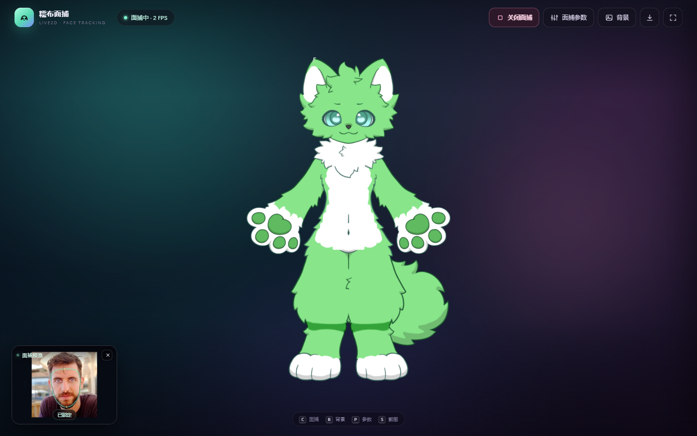

# 糯布面捕 · WebL2D

在浏览器里用摄像头实时驱动 Live2D 模型：转头、眨眼、说话、微笑都会同步到模型上，并支持自定义背景和面捕参数调节。所有画面与推理都在本机浏览器内完成，没有服务器，也不会上传。



## 功能

- **摄像头面捕**：MediaPipe Face Landmarker（478 个面部关键点 + 52 个表情系数），映射到 Live2D 的头部、眼睛、嘴、眉毛、表情、身体参数。
- **自动校准**：开启后保持正脸约 1 秒，自动记录头部中点、眨眼/眉毛/眼神的静息值，避免“一直斜眼/皱眉”。可随时重新校准。
- **自定义背景**：极光、暮色、纯色、上传图片（支持拖入）、摄像头实时虚化、透明棋盘；可调模糊和压暗。
- **面捕参数**：头部、眼神、嘴、眉毛、表情、身体六组强度，平滑、转动上限、镜像、关键点显示、鼠标跟随。
- **视图控制**：缩放、上下/左右位置、截图、全屏。
- **截图合成**：把当前背景和模型合成为 PNG 下载（不包含网页 UI）。
- **纯本地**：所有依赖、模型、WASM 都在站点目录里，不调用外部接口；首次加载完成后，断网也不影响模型渲染和面捕推理。

## 部署到 GitHub Pages

这是一个**纯静态站点**：没有构建步骤、没有后端、没有 npm 依赖安装。GitHub Pages 只需要把文件原样托管即可。

### 方式 A：GitHub Actions（推荐，仓库已带 workflow）

1. 把 **`WebL2D` 文件夹里的内容**作为仓库根目录推送（`index.html`、`.nojekyll`、`.github/workflows/pages.yml` 都要在根目录）。
2. 打开仓库 **Settings → Pages → Build and deployment → Source**，选择 **GitHub Actions**。
3. 推送到 `main`（或 `master`）后，Actions 会自动执行 `.github/workflows/pages.yml`。默认分支不是这两个时，在 Actions 页面手动点一次 **Run workflow**，或按实际分支修改 workflow。
4. 部署完成后的地址：
   - 普通仓库：`https://<用户名>.github.io/<仓库名>/`
   - 用户主页仓库（仓库名 `<用户名>.github.io`）：`https://<用户名>.github.io/`

### 方式 B：从分支直接发布

1. 把内容推到 GitHub 的 `main` 分支。
2. **Settings → Pages → Source** 选择 **Deploy from a branch**，分支 `main`，目录 `/ (root)`。
3. 保存后等待 1–2 分钟。根目录的 `.nojekyll` 会阻止 Jekyll 处理这些静态文件。

> 方式 A 和方式 B 二选一。选方式 B 时建议把 `.github/workflows/pages.yml` 删除或停用，否则 Actions 里可能出现一次失败的部署记录；这不影响分支发布本身。

### 部署注意

- 必须把 `WebL2D` **里面的内容**放在仓库根目录，不要再多套一层 `WebL2D/`；否则站点地址会变成 `.../<仓库名>/WebL2D/`。如果确实要放子目录，请把 workflow 里 `Prepare static site` 的路径改成对应子目录。
- 所有资源都使用相对路径，因此项目页 `/<仓库名>/` 和用户页 `/` 都能正常工作。
- GitHub Pages 默认提供 HTTPS，摄像头权限可以正常申请；不要用 HTTP 的局域网地址访问。
- `.task`、`.wasm` 合计约 22MB，远低于 GitHub Pages 单文件 100MB / 站点 1GB 的限制。
- 已内置 `.mjs` 的 MIME 回退：如果 Pages 把 `vision_bundle.mjs` 返回成 `application/octet-stream`，会自动改用 Blob 方式加载。
- 不要把 `.deps/`、`_dev/` 提交到仓库，`.gitignore` 已经排除。
- 第一次部署如果 404，先看仓库 Actions 是否还在跑，或 Pages 设置里是否已经显示 “Your site is live”。

## 本地运行（开发 / 预览）

部署到 Pages 不需要这一步；本地预览、改代码时用：

需要 **Python 3.9+**（Windows 上也可以用 `py -3`）。

1. 双击 **`start.cmd`**。
2. 浏览器会自动打开 `http://127.0.0.1:5180/`（端口被占用时会自动换一个，以窗口里的地址为准）。
3. 点「开启摄像头面捕」，允许摄像头权限。

或者手动启动：

```bash
python server.py --open
```

> 不能直接双击 `index.html`：浏览器的 ES Module、WASM 和摄像头权限都需要通过 `http://127.0.0.1`（或 HTTPS）访问。

## 使用方式

- **第一次进入**：可以点「先看看模型」进入浏览模式；鼠标移动时模型会追着光标看。
- **开启面捕**：点右上角相机按钮或欢迎页的「开启摄像头面捕」。首次浏览器会请求权限。
- **校准**：开启后保持正脸约 1 秒，状态栏显示「正在校准」。校准完成后就可以自由动。换人、换姿势后，在「面捕参数 → 摄像头 → 重新校准」再校准一次。
- **拖动/说话**：左右转头、抬头低头、歪头、眨眼、张嘴、微笑/皱眉都会同步。嘴部对说话比较敏感，可以用「嘴部开合」滑杆调低。
- **背景**：右上角「背景」打开面板，选预设或上传图片。图片也可以直接拖进页面。
- **截图**：右上角下载图标，或按 `S`。截图会带上当前背景。
- **隐藏摄像头预览**：预览右上角的 ×；在「视图」里可以重新打开。

### 快捷键

| 键 | 功能 |
| --- | --- |
| `C` | 开启 / 关闭摄像头 |
| `B` | 打开背景面板 |
| `P` | 打开面捕参数面板 |
| `S` | 保存截图 |
| `F` | 全屏 |
| `Esc` | 关闭面板 |

## 自定义

### 换模型

把 Cubism 3/4/5 的模型目录放进 `L2d_model/`，然后编辑根目录的 `models.json`：

```json
[
  {
    "id": "nobu",
    "name": "修长小狗 · 糯布",
    "subtitle": "绿色长腿小狗",
    "path": "L2d_model/修长小狗_糯布/修长小狗_糯布.model3.json",
    "accent": "#7ef0c8"
  }
]
```

- 必须使用 `.model3.json`（Cubism 3/4/5）；Cubism 2 的 `.model.json` 不支持。
- 纹理、物理、表情等文件路径和文件名按模型原样放在同目录即可，中文/空格路径没问题。
- 目前界面会使用列表里的**第一个**模型。以后要加模型切换，可以按这个数组继续扩展。
- 模型缺少某些参数时会被自动跳过，不会报错。

### 调整面捕手感

「面捕参数」里：

- **头部转动 / 眼神与眨眼 / 嘴部开合 / 眉毛 / 表情 / 身体摆动**：0–200% 强度。
- **平滑**：越高越稳、越低越跟手。
- **转动上限**：限制最大转头角度（10–30°），防止模型转得太夸张。
- **镜像跟随**：默认开启，像照镜子一样同向转动；关闭后模型会朝相反方向转。
- **面部关键点**：在左下角预览里画出 478 点轮廓，方便确认是否捕捉到脸。
- **鼠标跟随**：摄像头关闭时，模型会追着鼠标看。

### 背景

- **极光 / 暮色**：CSS 动画光晕，性能开销低。
- **纯色**：自选颜色。
- **图片**：上传或拖入，自动压缩到最长边 1920px 并保存在浏览器 localStorage；太大时会提示只对本次打开有效。
- **摄像头**：把摄像头画面虚化后作为背景（自动建议 16px 模糊）。关闭摄像头后会清空，不会留下冻结画面。
- **透明**：棋盘格，便于观察模型透明区域。

## 目录结构

```
WebL2D/
├─ index.html                 页面
├─ css/style.css              样式
├─ js/
│  ├─ app.js                  入口 / UI / 摄像头流程
│  ├─ scene.js                Live2D 渲染与参数写入
│  ├─ tracker.js              摄像头 + MediaPipe 封装
│  ├─ mapper.js               关键点/表情 → Live2D 参数
│  ├─ background.js           背景与截图合成
│  ├─ config.js               默认设置、背景预设、参数表
│  └─ utils.js                工具函数
├─ vendor/
│  ├─ pixi.min.js             PixiJS 6.5.10
│  ├─ live2dcubismcore.min.js Live2D Cubism Core 5.1
│  ├─ cubism4.min.js          pixi-live2d-display 0.4.0 (Cubism 4 runtime)
│  └─ mediapipe/              MediaPipe Tasks Vision + WASM
├─ assets/models/face_landmarker.task
├─ L2d_model/                 模型目录
├─ models.json                模型列表
├─ screenshots/               README 预览图
├─ .github/workflows/pages.yml GitHub Pages 自动部署
├─ .nojekyll                  GitHub Pages 静态发布标记
├─ .gitignore
├─ server.py                  本地静态服务器（.mjs/.wasm MIME、禁用缓存）
├─ start.cmd                  Windows 本地一键启动
├─ README.md
└─ THIRD_PARTY_NOTICES.md
```

## 面捕参数映射

| MediaPipe | Live2D 参数 | 说明 |
| --- | --- | --- |
| 鼻尖相对眼睛/脸颊的偏移 | `ParamAngleX` | 左右转头 |
| 鼻尖相对眼睛/下巴的纵向比例 | `ParamAngleY` | 抬头/低头 |
| 双眼连线角度 | `ParamAngleZ` | 歪头 |
| `eyeBlinkLeft/Right` | `ParamEyeLOpen/ParamEyeROpen` | 眨眼（静息值去噪） |
| `eyeLookIn/Out/Up/Down` | `ParamEyeBallX/ParamEyeBallY` | 眼神 |
| `jawOpen` | `ParamMouthOpenY` | 张嘴 |
| `mouthSmile/Frown` | `ParamMouthForm` | 微笑/皱眉 |
| `browInnerUp` / `browDown` / `browOuterUp` | `ParamBrowLY/ParamBrowRY` | 眉毛（带校准） |
| `mouthSmile` / `cheekPuff` | `ParamCheek` | 脸红 |
| `tongueOut` | `ParamTongue` | 吐舌 |
| `noseSneer` | `ParamNose` | 皱鼻 |
| `ParamAngleX` 派生 | `ParamBodyAngleX` | 身体跟随 |
| 时间正弦 | `ParamBreath` | 待机呼吸 |

校准会记录：头部 X/Y/Z 中点、`jawOpen` 静息值、眼神静息值、眉毛静息值、微笑/皱眉静息值。所有参数写入都发生在模型动作更新之后、物理计算之前，因此模型自带的 idle motion 不会覆盖面捕，头发/尾巴物理也会跟着面捕角度动。

## 常见问题

**摄像头权限被拒绝**
点地址栏左侧的摄像头/站点信息图标，把「摄像头」改为允许，再点一次「开启面捕」。如果之前点了“阻止”，需要在浏览器设置 → 隐私 → 摄像头里找到本站并移除阻止。

**没有找到摄像头 / 摄像头被占用**
确认摄像头没被会议软件、OBS、相机应用占用；笔记本检查键盘上的摄像头开关。设备选择在「面捕参数 → 摄像头 → 设备」。

**页面打不开 / 模型加载失败**
- 本地：请用 `start.cmd` 或 `python server.py --open` 启动，不要直接打开 `index.html`。确认 `L2d_model`、`vendor`、`assets` 三个目录完整。
- GitHub Pages：确认仓库**根目录**有 `index.html`、`vendor/`、`assets/`、`L2d_model/`、`models.json`；确认 Actions 部署成功、Pages 已选择正确分支/Artifact。强刷一次（Ctrl+F5）。

**GitHub Pages 部署后 404**
先看仓库 Actions 页面的 `Deploy WebL2D to GitHub Pages` 是否成功；再检查 Settings → Pages 的 Source。项目页地址是 `https://<用户名>.github.io/<仓库名>/`，不要漏掉末尾斜杠。首次部署可能需要等 1–2 分钟。

**GitHub Pages 上摄像头权限弹不出来**
确认打开的是 `https://` 地址（Pages 默认提供），不要用 HTTP 的局域网 IP；手机浏览器也要求 HTTPS 或 localhost。

**画面是黑的**
确认浏览器开启了硬件加速（WebGL）。如果模型能显示但摄像头黑，检查浏览器权限和摄像头是否被占用。

**手机/平板打不开摄像头**
浏览器只在 HTTPS 或 `localhost` 下允许摄像头。手机通过局域网 IP 访问 `http://192.168.x.x:5180` 属于不安全环境，需要在手机上用 `localhost` 转发或给站点配 HTTPS。

**帧率低**
面捕推理优先使用 GPU；GPU 不可用时会自动回退 CPU。降低摄像头分辨率/关闭其他占用 GPU 的程序会有帮助。左下角预览隐藏后仍然会继续推理，只是不显示画面。

**截图里没有网页 UI**
这是设计如此：截图只合成背景 + 模型。需要带 UI 的截图请用系统截图工具。

## 隐私

- 摄像头画面只进入浏览器内的 MediaPipe 推理和 Live2D 渲染。
- 没有后端、没有上传接口、没有统计脚本。
- 设置和背景图保存在浏览器 `localStorage`，只在本机。
- 关闭摄像头或关闭页面后，摄像头轨道会被停止。

## 技术栈与致谢

- [PixiJS](https://pixijs.com/) 6.5.10 — MIT
- [pixi-live2d-display](https://github.com/guansss/pixi-live2d-display) 0.4.0 — MIT
- [Live2D Cubism Core](https://www.live2d.com/sdk/cubism/) 5.1 — Live2D 专有许可，使用/分发前请阅读 Live2D 的 SDK 授权条款
- [MediaPipe Tasks Vision](https://ai.google.dev/edge/mediapipe/solutions/vision/face_landmarker) / Face Landmarker 模型 — Apache 2.0
- 测试模型「修长小狗 · 糯布」版权归模型作者所有

详细许可见 [THIRD_PARTY_NOTICES.md](THIRD_PARTY_NOTICES.md)。
